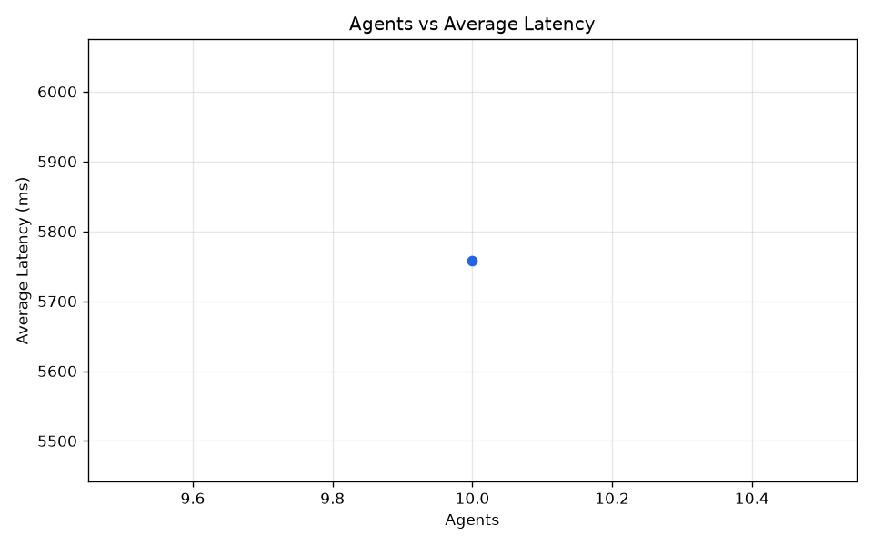
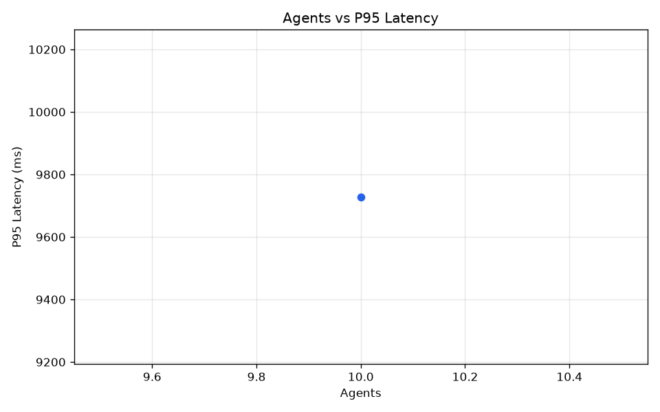
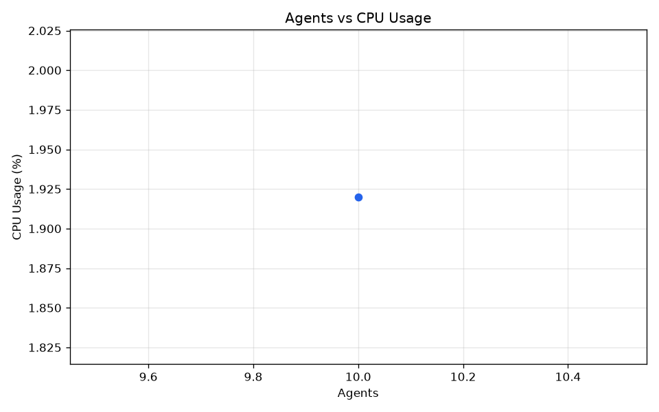
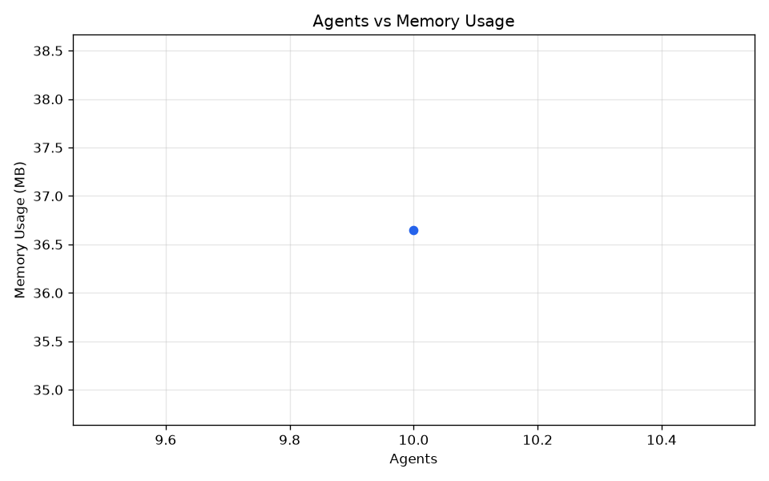
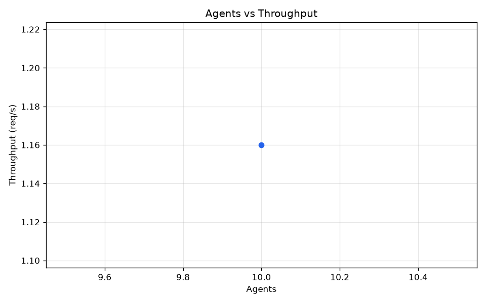

# Dikoryx Automated Benchmark Report

**Generated:** 2026-06-27T13:46:54.116534+00:00

## Environment

| Property | Value |
| --- | --- |
| Python | 3.11.9 |
| OS | Windows 10 |
| CPU | 13th Gen Intel(R) Core(TM) i7-13620H (16 cores) |
| RAM | 15.6 GB |
| Database | `unknown` |
| Git commit | `9493a76eecf4` |
| Git branch | `main` |

## Test Configuration

| Setting | Value |
| --- | --- |
| Base URL | http://127.0.0.1:8000 |
| Duration (s) | 60.0 |
| Warmup (s) | 2.0 |
| Min interval (s) | 1.0 |
| Max interval (s) | 5.0 |
| Sample interval (s) | 1.0 |
| Request timeout (s) | 10.0 |
| Output directory | tests\performance\results |
| Agents | 10 |

## Results Summary

| Agents | Duration | Events | Req/s | Avg Latency | P95 | P99 | Success | Failures |
| ---: | ---: | ---: | ---: | ---: | ---: | ---: | ---: | ---: |
| 10 | 60s | 256 | 1.16 | 5758.29 ms | 9728.10 ms | 10013.58 ms | 69 | 3 |

## Graphs

### Agents Vs Average Latency

### Agents Vs P95

### Agents Vs Cpu Usage

### Agents Vs Memory Usage

### Agents Vs Throughput

